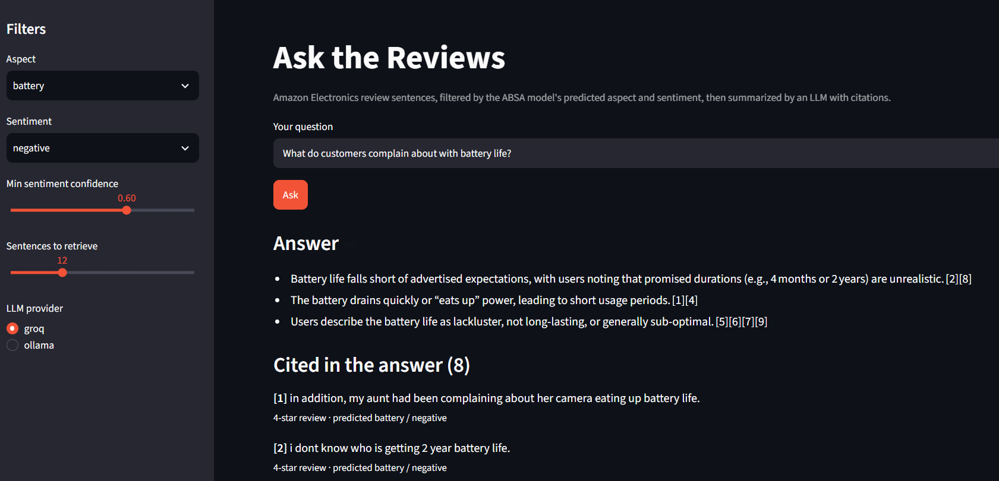
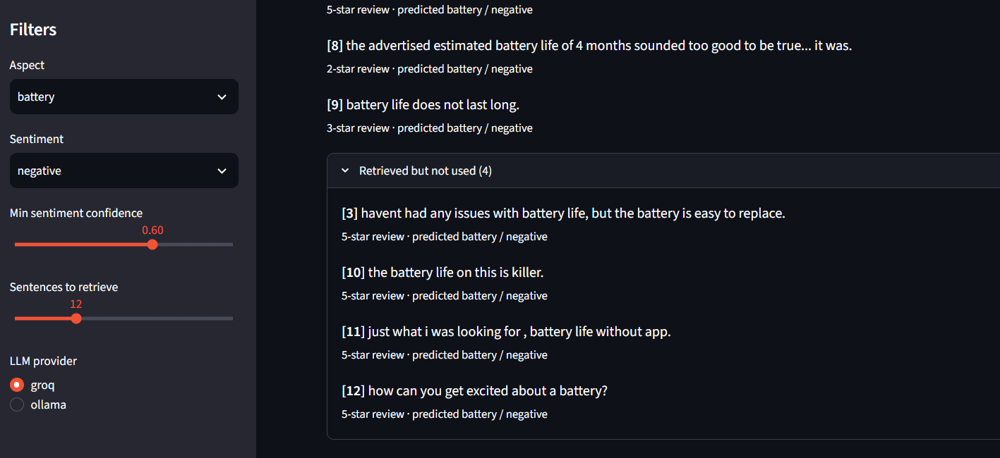

# Aspect-Based Sentiment Analysis (ABSA) + RAG on Amazon Electronics Reviews

An end-to-end NLP project in two layers:

1. **ABSA pipeline**: identifies **which product feature** a review sentence talks about (battery, sound, price, and 5 others) and **how the reviewer feels** about it (positive or negative).
2. **RAG layer**: uses those predicted labels to answer plain-English questions such as *"What do customers complain about with battery life?"*, with every point **cited** back to the review sentences it came from.

Unlike standard sentiment analysis, which gives one label per review, this system works at the sentence level, so a single review can contribute several aspect-opinion pairs.

## Highlights

- **Sentence-level analysis**: captures multiple aspect-opinion pairs per review
- **Review-level splitting**: sentences from the same review never appear in both train and test (no data leakage)
- **Frozen DistilBERT embeddings + PyTorch DNNs** for aspect classification (8 classes) and sentiment classification (binary)
- **Label-filtered RAG**: the classifier's predictions filter a Chroma vector database before semantic search, then an LLM writes a cited answer
- **Measured, not assumed**: retrieval with vs. without the model filter is evaluated against reference labels

---

## Project Structure

```
AspectBasedSentimentAnalysis/
├── configs/
│   └── config.yaml                 # Dataset URL, aspect keywords, sentiment thresholds,
│                                   # model hyperparameters, output paths
├── src/absa/                       # The ABSA package (installed with pip install -e .)
│   ├── data/
│   │   └── loader.py               # Download reviews, clean text, split into sentences,
│   │                               # review-level train/test split, remove "general", balance
│   ├── labeling/
│   │   └── keyword_labeler.py      # Aspect labels from keywords, sentiment labels from star rating
│   ├── models/
│   │   ├── embeddings.py           # DistilBERT CLS-token embedding extraction (frozen)
│   │   ├── neural_networks.py      # AspectClassifier (8-way) and SentimentClassifier (binary)
│   │   └── trainer.py              # Training loop, early stopping, LR scheduling, predict()
│   ├── eval/
│   │   └── metrics.py              # Accuracy, macro-F1, per-class accuracy, confusion matrices
│   └── pipeline.py                 # Runs the full ABSA pipeline end to end
├── rag/                            # RAG layer built on top of the ABSA predictions
│   ├── export_predictions.py       # Runs the pipeline and saves test-set predictions to CSV
│   ├── build_index.py              # Embeds sentences and stores them in Chroma with labels
│   ├── rag_core.py                 # Filter → retrieve → LLM answer with citations
│   ├── app.py                      # Streamlit web app (filters + question box)
│   └── evaluate.py                 # Compares retrieval with vs. without the model filter
├── notebooks/
│   └── Aspect_Based_Sentiment_Analysis.ipynb   # Full run with analysis and visualizations
├── tests/
│   ├── conftest.py                 # Shared test fixtures
│   └── test_data.py                # Tests for cleaning, splitting, labeling, balancing
├── scripts/
│   └── validate_package.py         # Checks that all package modules import correctly
├── docs/images/                    # Screenshots used in this README
├── data/processed/                 # Generated data (not committed)
├── results/                        # Generated predictions and evaluation files (not committed)
├── .env.example                    # Template for API keys (copy to .env)
├── pyproject.toml                  # Package definition and dependencies
└── README.md
```
## Part 1: ABSA Pipeline

### How it works

`src/absa/pipeline.py` runs these steps, all controlled by `configs/config.yaml`:

1. **Load** 50,000 Amazon Electronics reviews, streamed from the [McAuley-Lab Amazon Reviews 2023](https://huggingface.co/datasets/McAuley-Lab/Amazon-Reviews-2023) dataset on Hugging Face.
2. **Clean and split** each review into sentences, keeping sentences with at least 5 words.
3. **Label** each sentence:
   - **Aspect** by keyword matching (e.g. "charge", "drain" → `battery`; "screen", "resolution" → `display`)
   - **Sentiment** from the review's star rating (4–5 → positive, 1–2 → negative, 3 → neutral and dropped)
4. **Split at the review level** (80/20, stratified by rating) so no review appears in both sets.
5. **Remove** sentences with no aspect keyword, and **balance** the training set to at most 500 sentences per aspect × sentiment pair.
6. **Embed** each sentence with frozen `distilbert-base-uncased` (768-dim CLS token).
7. **Train** two PyTorch networks (768 → 512 → 256 → output) with dropout, batch norm, L2 regularization, early stopping, and learning-rate scheduling.

### Results

| Model | Architecture | Accuracy | Macro-F1 |
|-------|-------------|----------|----------|
| Aspect Classifier | DistilBERT → 768→512→256→8 | 81.08% | 0.78 |
| Sentiment Classifier | DistilBERT → 768→512→256→1 | 74.19%* | — |

\* The original pipeline thresholded raw logits at 0.5 instead of probabilities, which reported 63.64%. Applying the sigmoid correctly (as `rag/export_predictions.py` does) gives 74.19% on the non-neutral test sentences.

#### Aspect Classifier: Per-Class Breakdown

| Aspect | Accuracy | Samples | Notes |
|--------|----------|---------|-------|
| sound | 86.7% | 2,604 | Best performer, distinct keywords |
| price | 84.9% | 1,567 | Strong signal from cost/value terms |
| display | 83.4% | 988 | Some confusion with camera |
| camera | 82.3% | 2,225 | |
| connectivity | 78.9% | 695 | Limited training samples |
| battery | 78.5% | 2,794 | Occurs in many contexts, some noise |
| design | 73.8% | 1,349 | Overlaps with build quality terms |
| performance | 67.4% | 846 | Most confused: "fast/slow" used across categories |

#### Sentiment Classifier: Why It Is Harder

Sentiment labels come from the **overall star rating**, not the sentence. A 5-star review can contain *"but the battery dies fast"*, which is labeled positive. Combined with natural imbalance (~82% of sentences are positive), the model is weaker on negatives and is sometimes confidently wrong. The RAG layer below is designed to work around this.

---

## Part 2: RAG Layer

### What it does

Pick an aspect and a sentiment, ask a question, and get a short written answer where every point cites the review sentences behind it.

**Example**: filters **battery + negative**, question *"What do customers complain about with battery life?"*

- Battery drains quickly and doesn't last as long as expected [1][4][6][9]
- Battery life is described as lackluster or less than optimal [5][7]
- Advertised battery-life claims are seen as unrealistic [2][8]



### How it works

```
predictions.csv ──► build_index.py ──► Chroma vector DB (sentence + embedding + labels)
                                                │
User picks filters + asks question ─────────────┤
                                                ▼
                          1. Keep only sentences whose PREDICTED labels match the filters
                          2. Retrieve the 12 closest in meaning to the question
                          3. LLM summarizes them, cites each point, ignores misfits
                                                ▼
                                   Answer + cited sources (app.py)
```

### What each file does

| File | What it does |
|------|-------------|
| `rag/export_predictions.py` | Imports and runs `run_full_pipeline()`, re-runs both trained models on the 13,068 test sentences, converts logits to probabilities (softmax for aspect, sigmoid for sentiment), and saves each sentence with its predicted aspect, predicted sentiment, confidence scores, star rating, and reference labels to `results/predictions.csv`. |
| `rag/build_index.py` | Reads `predictions.csv`, turns each sentence into a LangChain `Document` with its **predicted** labels and confidence as metadata, embeds it with `sentence-transformers/all-MiniLM-L6-v2`, and stores everything in a Chroma database at `rag/chroma_db/`. Rebuilds from scratch on every run. |
| `rag/rag_core.py` | The core logic. `build_filter()` turns the user's choices into a Chroma metadata filter. `retrieve()` runs filtered semantic search. `format_context()` numbers the sentences [1], [2], ... `answer()` sends them to the LLM (Groq or local Ollama) with a prompt that requires using only the given sentences, citing every point, and ignoring sentences that don't fit the question. Returns the answer and the source list. |
| `rag/app.py` | Streamlit interface: sidebar dropdowns for aspect and sentiment, sliders for minimum sentiment confidence and number of sentences, a provider switch (Groq / Ollama), and a question box. Shows the answer, the cited sentences, and a collapsible list of retrieved sentences the LLM chose not to use. |
| `rag/evaluate.py` | For all 16 aspect × sentiment combinations, retrieves 12 sentences with and without the model filter and checks them against the reference labels. Saves details to `results/rag_eval.csv` and prints the averages. |

### Design choices

- **Why filter on predicted labels, not true labels?** In real use, new reviews have no true labels. Filtering on the classifier's output is how the system would actually run.
- **Why a separate embedding model?** Frozen DistilBERT CLS embeddings feed the classifier well but aren't trained for sentence similarity. `all-MiniLM-L6-v2` is built for semantic search.
- **Why let the LLM reject sentences?** The sentiment model is sometimes confidently wrong (e.g. it labeled *"the battery life on this is killer"* as negative with 0.91 confidence), so a confidence threshold alone can't remove those errors. The LLM is good at telling praise from complaints on a small set of sentences.

### Does the model filter help?

Results from `rag/evaluate.py` (12 sentences retrieved per query, 16 queries):

| Retrieval | Correct aspect | Correct sentiment |
|-----------|---------------|-------------------|
| Semantic search only | 89.1% | 46.4% |
| Model filter + semantic search | **92.7%** | **56.2%** |

Semantic search already finds the right **topic**, but it can't tell praise from complaints: 46% correct sentiment is close to a coin flip. The classifier's labels add the missing **opinion** signal (+9.8 points). The LLM then removes remaining mislabeled sentences: in the battery example it rejected 4 of 12 retrieved sentences, including *"the battery life on this is killer"*.



---

## Installation

Requires Python 3.10+.

```bash
git clone https://github.com/Sushmitab93/AspectBasedSentimentAnalysis.git
cd AspectBasedSentimentAnalysis
python -m venv .venv
.venv\Scripts\activate              # Mac/Linux: source .venv/bin/activate

pip install -e .                    # ABSA pipeline only
pip install -e ".[rag]"             # ABSA + RAG layer
pip install -e ".[dev]"             # + testing and linting tools
```

For the RAG layer, copy `.env.example` to `.env` and add a free API key from [Groq](https://console.groq.com):

```
GROQ_API_KEY=your_groq_key_here
GROQ_MODEL=openai/gpt-oss-120b
```

To run fully offline instead, install [Ollama](https://ollama.com), run `ollama pull llama3.1`, and choose **ollama** in the app.

## Usage

### Run the ABSA pipeline

```python
from absa.pipeline import run_full_pipeline
results = run_full_pipeline()
```

Or explore it step by step in `notebooks/Aspect_Based_Sentiment_Analysis.ipynb`, which also includes confidence distribution analysis, edge-case testing, a confusion matrix, and interactive single-review analysis.

### Run the RAG layer

Run these from the repo root, in order:

```bash
python rag/export_predictions.py     # trains models, saves results/predictions.csv
python rag/build_index.py            # builds the Chroma database in rag/chroma_db/
streamlit run rag/app.py             # opens the app at http://localhost:8501
python rag/evaluate.py               # optional: filter vs. no-filter comparison
```

## Testing

```bash
pytest tests/ -v
pytest tests/ --cov=src/absa         # with coverage
python scripts/validate_package.py   # check that all modules import
```

## Tech Stack

**ML / NLP**: Python, PyTorch, Hugging Face Transformers (DistilBERT), scikit-learn, NLTK, pandas, NumPy
**RAG**: LangChain, Chroma (vector database), Sentence-Transformers (`all-MiniLM-L6-v2`), Groq API, Ollama
**App / tooling**: Streamlit, python-dotenv, pytest, Matplotlib, Seaborn

## Known Issues & Future Work

- Keyword-based aspect labeling is noisy; a sequence-labeling (NER-style) model would be more accurate.
- Sentiment comes from the overall star rating, not sentence-level annotations; class-weighted loss or sentence-level labels would help.
- The neutral class (3-star) is dropped entirely.
- RAG evaluation uses keyword/rating-based reference labels, so the numbers are approximate. A small hand-labeled set would give a more reliable measure, and answer quality (faithfulness of citations) could be scored automatically.

## Feedback & Contributions

Found a bug or have an idea? [Open an issue](https://github.com/Sushmitab93/AspectBasedSentimentAnalysis/issues). Contributions welcome. This is a learning project and I'd love to improve it with community input.